# Forge / NeoForge 服务端识别

识别从启动脚本静态解析出的 `ServerLaunch` 开始，证据来自启动参数、启动 JAR 的元数据和命令直接引用的路径。

图中 `Ok(Some(identity))` 表示识别成功，`Ok(None)` 表示当前检测器不认领，`Err` 表示当前启动命令的证据无法解析、缺失或冲突。有其他已识别的候选时，上层仍会保留它们。

## 识别流程

相同编号连接同一张图里的分流出口与后续入口。报错使用代码原文；花括号是格式参数。

## 对应实现

| 职责 | 源码 |
| --- | --- |
| 入口分发 | [Forge](../../src/local/modloader/impls/fml/forge/server/mod.rs) · [NeoForge](../../src/local/modloader/impls/fml/neoforge/server.rs) |
| 内嵌数据 | [Forge Shim](../../src/local/modloader/impls/fml/forge/server/shim.rs) · [旧版 Forge](../../src/local/modloader/impls/fml/forge/server/legacy.rs) · [Java 字段常量](../../src/local/java/class.rs) |
| 家族与版本 | [共享 FML 规则](../../src/local/modloader/impls/fml/server.rs) · [Maven 路径匹配](../../src/local/modloader/impls/utils/coordinate.rs) |

## `init` 提示

启动命令因未知脚本状态无法识别时，错误链包含 `script state became unknown at {script:?}:{line}`。

**Tip:** Retry with `--ignore-unknown-vars` (`-I`) if the skipped statements can safely be ignored. This keeps the previous working directory and variable values.

Raw 下有多个候选时，报 `multiple identified server launches found; selection requires an interactive terminal`。

**Tip:** Run init in an interactive terminal without --raw to choose a launch, or supply complete version and loader options to initialize manually without importing a startup script.

该 Tip 随后列出每个候选的身份、脚本位置、`Main`、`Entry` 和 `Arguments`。
