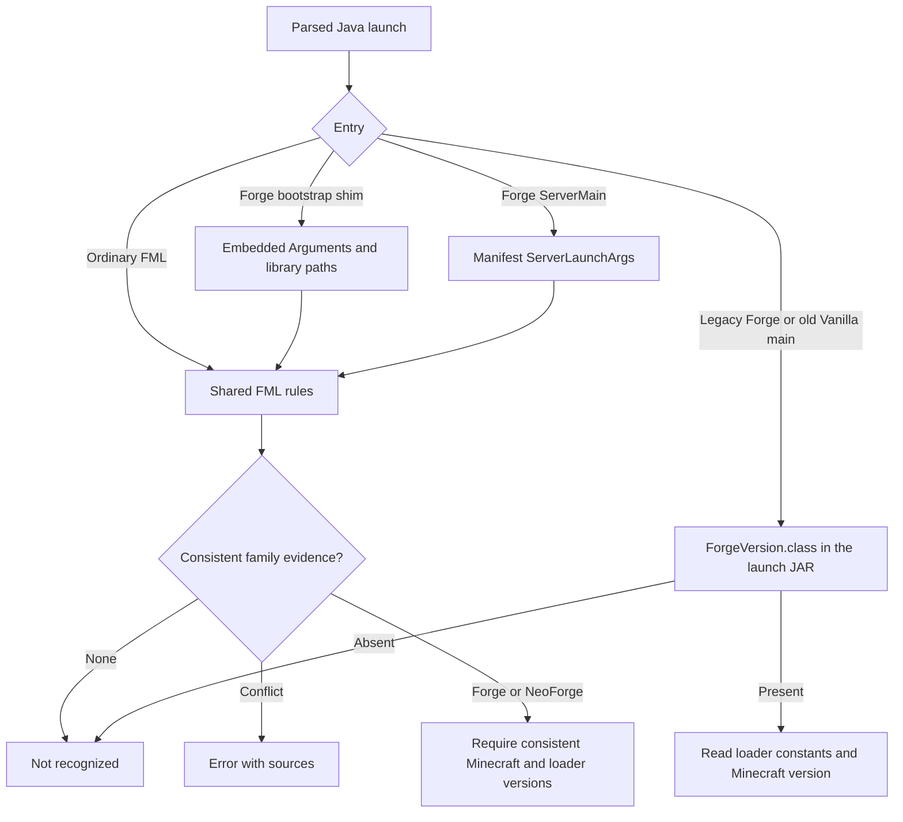

# Forge and NeoForge identification

Identification lives in `mcpm-lib` and receives a statically parsed `ServerLaunch`. It does not execute scripts, Java, or installers, and does not download dependencies.

- `Ok(Some(identity))`: identification succeeded; returns the Minecraft and loader versions.
- `Ok(None)`: the current detector does not handle this entry or family.
- `Err`: required evidence is missing, conflicting, or unreadable. The caller skips the current launch and keeps other identified candidates.

## Entry points and evidence

- [Forge server recognition](../../src/local/modloader/impls/fml/forge/server/mod.rs) adapts shim and `ServerMain` metadata before applying the [shared FML rules](../../src/local/modloader/impls/fml/server.rs). NeoForge uses those rules directly. Each detector returns only its own family.
- A family needs positive evidence: `--fml.forgeGroup`, a NeoForge version option, or a referenced `net.minecraftforge:fmlloader` / `net.neoforged.fancymodloader:loader` JAR. The historical `--fml.forgeVersion` name, shared libraries, and entry-class prefixes do not select a family. Known client targets are rejected.
- An explicit option overrides the same embedded default. **Effective options and distribution coordinates have equal weight**: both Minecraft and loader versions need at least one source, and all sources for each version must agree. FML component versions are not loader distribution versions. Coordinates come from referenced paths, including Maven-layout `unix_args.txt` / `win_args.txt` files actually expanded for the launch.
- The shim reads `bootstrap-shim.list` even when explicit arguments provide both versions. Recognition reads the list's referenced paths but does not open dependency JARs, verify hashes, or check installation completeness.
- For legacy Forge, four integer `ForgeVersion.class` constants identify the loader. The `mcVersion` string constant and `fmlversion.properties` (`fmlbuild.mcversion`) provide the Minecraft version; if both are present they must agree. Without `ForgeVersion.class`, the legacy detector does not claim the launch.
