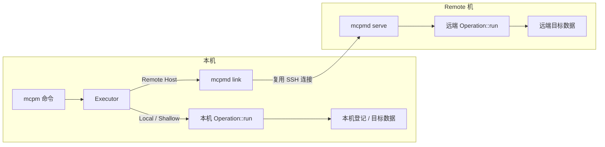

# mcpm 命令文档

## mcpm 的运作方式

mcpm 管理服务端、客户端、Mod 和缓存等。当前实现仍在迁移中，并非所有命令都走本节所述的执行模型。

### 执行模型

| 组件 | 职责 |
| --- | --- |
| mcpm | 参数解析、目标选择、交互、显示 |
| operation | 后端操作，定义输入、输出和执行逻辑 |
| Executor | 按目标选择本机直接执行，或交给远端 mcpmd |
| mcpmd link | 本机进程，为同一 SSH 目标复用一条连接 |
| mcpmd serve | 远端进程，执行 operation |

调用流程：

1. mcpm 确定操作对象和执行位置。支持远端的命令中，显式 `--ssh` 优先；否则读取本机登记。
2. Executor 选择本机或远端。连接失败不改为本机执行。
3. 本机执行直接调用 operation，不经过序列化。
4. 远端执行通过本机 link 和远端 `mcpmd serve`，同一连接可承载多个调用。

Operation 分为两类：

| 分类 | 范围 |
| --- | --- |
| Shallow | 只操作本机登记或管理数据，始终在本机执行 |
| Host | 操作目标主机上的实际数据或目录，按目标在本机或远端执行 |

### 当前迁移状态

| 命令或功能 | 状态 |
| --- | --- |
| `server info`、`server init` | 已迁移到 operation + Executor + mcpmd |
| `workspace.inspect`、`workspace.register_remote` | 已迁移，Shallow operation |
| `server stash.*` | 已迁移，Host operation |
| `server launch` | 未迁移 |
| `server mods.*`、`mods.*`、`cache.*` | 未迁移 |
| `client.*` | 未迁移 |

已迁移的远端命令需要远端安装 mcpmd。支持远端的未迁移命令仍使用旧的 remote 协议，远端需要 mcpm-tools；迁移完成前，远端可能同时需要两者。

## 术语

| 术语 | 含义 |
| --- | --- |
| 位置参数 PATH | 命令的目录参数；省略时默认当前目录，具体目标见各命令说明 |
| Host | 实际保存服务端目录的机器 |
| 服务端目录 | 包含 Minecraft 服务端文件，由 mcpm 检查或初始化的目录 |
| Local Server | 工作区类型为 Local 的服务端；没有 `.mcpm/mcpm.json` 的旧目录也按 Local 处理 |
| Remote workspace | 本机目录，保存 SSH 连接和远端服务端路径，不保存服务端文件 |
| 登记 | `.mcpm/mcpm.json` 和 `.mcpm/server.json` 保存的工作区类型、连接或身份信息 |
| Loader | 服务端 Mod 加载器，如 fabric、forge、neoforge；vanilla 表示原版 |
| mcpmd | 执行远端 operation 的程序；当前用于已迁移的服务端命令 |
| link | 本机为某个 SSH 目标维护的可复用连接进程 |

## 通用选项

服务端与 Tools 入口提供以下选项，可放在子命令前后；具体命令是否接受以对应文档和 `--help` 为准。

| 选项 | 说明 |
| --- | --- |
| `--ssh <COMMAND>` | SSH 连接命令，例如 `ssh -i key user@host`。指定后，位置参数 PATH 按该主机解释。 |
| `--ssh-mcpmd <PATH>` | 远端可执行文件；要求 `--ssh`。迁移后的 `info`、`init`、`stash` 使用远端 mcpmd；未迁移命令使用其原有远端程序。省略时按对应默认值查找。 |
| `--log-level <LEVEL>` | stderr 诊断级别：`off`、`error`、`warn`、`info`、`debug`、`trace`；默认 `warn`。 |
| `--remote-logs` | 在本机 stderr 显示远端日志，级别由 `--log-level` 过滤。 |
| `--raw` | 使用 Raw 模式。 |
| `-h, --help` | 显示帮助。 |

SSH 使用密钥或 ssh-agent 非交互认证；未知 host key 需先手动 SSH 接受。Windows SSH 默认 shell 要求为 cmd。连接失败不改为本机执行。

## 输出模式

| 模式 | 选择方式 | 输出 |
| --- | --- | --- |
| TUI | 命令支持且需要交互选择时的默认模式 | 本机交互界面 |
| Console | 终端 stdout 默认；命令可用 `--no-ui` 指定 | 格式化文本 |
| Raw | `--raw`，或 stdout 不是终端 | 禁用交互、格式和颜色；输出制表符分隔值（TSV）或原始数据 |

## 命令文档

- [Server 基础：info、init](server/basics.md)
- [Server stash](server/stash.md)
- [mcpmd：serve、link](../../mcpmd/docs-zh/README.md)
- [Legacy：尚未迁移（client、mods、cache、launch 等）](legacy/README.md)
- [Backend 模块](../../mcpm-backend/docs-zh/README.md)

[English](../docs/README.md)
