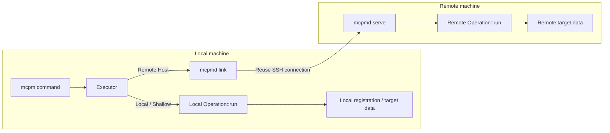

# mcpm commands

## How mcpm works

mcpm manages servers, clients, mods, caches, and other Minecraft resources. The implementation is still migrating, so not every command uses the execution model described here.

### Execution model

| Component | Responsibility |
| --- | --- |
| mcpm | Argument parsing, target selection, interaction, presentation |
| operation | Backend operation with input, output, and execution logic |
| Executor | Runs locally or delegates to remote mcpmd according to the target |
| mcpmd link | Local process reusing one connection per SSH target |
| mcpmd serve | Remote process executing operations |

Call flow:

1. mcpm determines the target object and execution location. For commands that support remote access, explicit `--ssh` wins; otherwise local registration is read.
2. Executor selects local or remote execution. Connection failure does not switch to local execution.
3. Local execution calls the operation directly without serialization.
4. Remote execution uses the local link and remote `mcpmd serve`; multiple calls share one connection.

Operations have two classifications:

| Classification | Scope |
| --- | --- |
| Shallow | Operates only on local registration or local management data; runs locally |
| Host | Operates on actual data or directories on the target machine; runs locally or remotely |

### Current migration status

| Command or feature | Status |
| --- | --- |
| `server info`, `server init` | Migrated to operation + Executor + mcpmd |
| `workspace.inspect`, `workspace.register_remote` | Migrated; Shallow operations |
| `server stash.*` | Migrated to Host operations |
| `server launch` | Not migrated |
| `server mods.*`, `mods.*`, `cache.*` | Not migrated |
| `client.*` | Not migrated |

Migrated remote commands require mcpmd on the remote machine. Unmigrated commands that support remote access still use the legacy remote protocol and require mcpm-tools; during migration, the remote machine may need both.

## Terms

| Term | Meaning |
| --- | --- |
| Positional PATH | Directory argument of a command; defaults to the current directory when omitted. The command documentation defines its target. |
| Host | Machine that actually stores the server directory |
| Server directory | Directory containing Minecraft server files, inspected or initialized by mcpm |
| Local Server | Server whose workspace type is Local; legacy directories without `.mcpm/mcpm.json` are also treated as Local |
| Remote workspace | Local directory storing an SSH connection and remote server path; it does not store server files |
| Registration | Workspace type, connection, or identity stored in `.mcpm/mcpm.json` and `.mcpm/server.json` |
| Loader | Server mod loader such as fabric, forge, or neoforge; vanilla means an unmodded server |
| mcpmd | Program executing remote operations; currently used by migrated server commands |
| link | Reusable connection process maintained locally for one SSH target |

## Common options

The server and Tools entries provide the following options, accepted before or after a subcommand. Individual commands define whether they support a given option; see their documentation and `--help`.

| Option | Description |
| --- | --- |
| `--ssh <COMMAND>` | SSH connection command, for example `ssh -i key user@host`. The positional PATH is interpreted on that host. |
| `--ssh-mcpmd <PATH>` | Remote executable; requires `--ssh`. Migrated `info`, `init`, and `stash` use remote mcpmd; unmigrated commands use their existing remote program. The corresponding default applies when omitted. |
| `--log-level <LEVEL>` | stderr diagnostic level: `off`, `error`, `warn`, `info`, `debug`, `trace`; default `warn`. |
| `--remote-logs` | Show remote logs on local stderr, filtered by `--log-level`. |
| `--raw` | Use Raw mode. |
| `-h, --help` | Show help. |

SSH uses key or ssh-agent authentication without prompts. Accept unknown host keys through a manual SSH connection first. Windows SSH requires cmd as its default shell. Connection failure never falls back to local execution.

## Output modes

| Mode | Selection | Output |
| --- | --- | --- |
| TUI | Default for interactive selection supported by a command | Local interactive interface |
| Console | Default for terminal stdout; a command may select it with `--no-ui` | Formatted text |
| Raw | `--raw`, or stdout is not a terminal | No interaction, formatting, or colors; TSV or raw data |

## Command documentation

- [Server: basics (info, init)](server/basics.md)
- [Server: launch and attach](server/launch.md)
- [Server: stash](server/stash.md)
- [mcpmd: serve and link](../../mcpmd/docs/README.md)
- [Legacy: not yet migrated (client, mods, cache, and others)](legacy/README.md)
- [Backend modules](../../mcpm-backend/docs/README.md)

[简体中文](../docs-zh/README.md)
